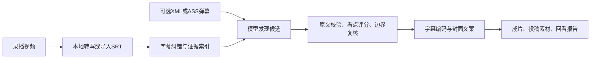

# ASoulAutoClip

一个面向中文直播录播的本地切片工具：自动转写、发现候选、核对字幕证据与事件边界，生成带字幕的视频、封面、标题、简介和回看报告。

主流程：**本地转写 → 词典纠错 → 有证据的候选选片 → 看点与边界复核 → 字幕及视频 → 投稿素材**。

目前以 Windows 本地使用为主。只有视频也能切片；有独立 XML/ASS 弹幕时可辅助理解和排序。可接收录播姬 Webhook v2，在录制结束、文件稳定后串行处理，默认缺 XML 时等待后仅使用视频。没有 B 站自动上传、逐句说话人分离或自动多段跳剪。选片以语音字幕为证据；动作高光、人物归属和最终发布内容仍需复核。

## 能做什么

| 输入 / 功能 | 当前行为 |
| --- | --- |
| 只有录播视频 | 本地 ASR 转写后选片，不要求有弹幕 |
| 视频 + XML/ASS 弹幕 | 抽样观众评论辅助理解；给“绷”附近增加查找与合格候选排序权重 |
| 已有对齐的 SRT | 可导入字幕；缺少可验证词时间时保留原字幕时间，不伪造短句时间 |
| 录播姬自动接入 | Webhook v2、持久化队列、录制结束与文件稳定校验、串行处理 |
| 本地转写后端 | 默认 faster-whisper；FireRedASR2-AED 可选、需独立安装 |
| 字幕与输出方向 | 青年体、84号统一黄字、底部短句；自动适配横竖屏 |
| 投稿准备 | 导出候选封面、标题、简介、标签及 `posting_manifest.json`，由用户复核后投稿 |



当前按**一个连续区间**生成一条切片。没有逐句说话人分离、视频弹幕 OCR、纯画面高光理解、片内多段跳剪或 B 站自动投稿。允许找不到合格片段，模型评分不代表准确率。

## 快速开始（Windows / CMD）

推荐 Python 3.12，需要 Git（克隆源码时）和已加入 `Path` 的 FFmpeg / ffprobe。源码不包含虚拟环境、模型权重、视频、API Key 或字体文件。默认字体需自行安装，见 [字体说明](resources/fonts/README.md)。首次转写需要下载模型；选片和文案阶段使用你配置的大模型 API。

从 GitHub 下载 ZIP 并解压，或克隆自己的仓库后进入项目根目录。在 **CMD** 中准备环境：

```bat
python --version
ffmpeg -version
ffprobe -version
if not exist .venv\Scripts\python.exe python -m venv .venv
.\.venv\Scripts\python.exe -m pip install -r requirements\asr.txt
```

然后创建本机配置，已有配置不会覆盖：

```bat
if not exist config\local mkdir config\local
if not exist config\local\highlights.json copy config\examples\highlights.example.json config\local\highlights.json
if not exist .env copy .env.example .env
```

编辑两个本机文件：

1. `config/local/highlights.json`：填写 `input.video`、`llm.model`；`input.srt` 留空则本地转写，`input.output_dir` 留空则自动分配任务目录。Windows 路径建议写成 `D:/recordings/example.mp4`。
2. `.env`：填写 `SILICONFLOW_API_KEY`。配置中的 `llm.api_key_env` 保持为环境变量名称，不要填写密钥本身。

检查并运行：

```bat
.\run_clips.cmd --check
.\run_clips.cmd --analyze-only
.\run_clips.cmd
```

三条命令分别用于检查、分析回看、正式出片。启动器也能创建或复用 `.venv`、按需安装依赖。`--check` 不下载转写模型、不调用选片 API；`--analyze-only` 会转写并调用选片 API，暂不编码。CUDA 运行库、模型和字体需按本机配置准备；前置检查通过不代表实际 GPU 推理已经验证。

默认转写后端为 faster-whisper。使用 FireRed 时，按 [FireRed 指南](docs/guides/firered.md) 安装独立环境、下载权重并修改 `asr`，不要把自己电脑的 `models/` 或 `.venv-firered/` 上传到仓库。

## 两种切片方式

只有视频时，配置中的 `danmaku.path` 保持空白即可。若之前配置过其他视频的弹幕，显式清空：

```bat
.\run_clips.cmd --config config\local\highlights.json --danmaku ""
```

有匹配视频时间轴的 XML/ASS 时：

```bat
.\run_clips.cmd --config config\local\highlights.json --danmaku "D:\recordings\example.xml"
```

弹幕只作语境与观众反应线索，最终引文仍来自语音字幕。已经烧录弹幕的 MP4 不能替代独立文件。手动指定的弹幕文件损坏、缺失或时间范围错误时会提示检查，详见 [弹幕输入与对齐](docs/guides/audience-and-danmaku.md)。

录播姬自动方式使用 `python -m scripts.recorder_service`。默认 `danmaku_policy=optional`，优先使用同名 XML，等待后仍缺失就只处理视频；`required` 则必须有 XML。应在录制前启动服务，配置步骤见 [录播接入指南](docs/guides/recorder-integration.md)。

## 输出与回看

新任务默认输出到 `outputs/<录播名称_标识>/`；有显式 `input.output_dir` 或 `--output` 时使用指定目录。

```bat
start "" "outputs\你的任务目录\report.html"
```

如果网页中视频一直显示 0:00，请在资源管理器中双击报告旁的 `open_preview.cmd`，用本机浏览器预览。旧报告也可运行 `python -m scripts.preview_report --report "报告完整路径"`。不需要重新转写或编码，详见 [预览说明](docs/guides/report-preview.md)。

每条通过的片段位于 `clips/<ID>/`，包含 `clip.mp4`、字幕、`cover.jpg`、候选封面、`title.txt`、`description.txt`、`tags.txt` 和 `metadata.json`。`posting_manifest.json` 汇总可用于投稿的素材；不会自动上传。

```text
outputs/<任务目录>/
├─ asr/                     转写缓存、词时间与来源回执
├─ transcript.indexed.json  字幕ID、时间、纠错与来源
├─ analysis.json            候选、证据、分数、弃选及失败原因
├─ report.html              回看报告
├─ open_preview.cmd         本机预览入口
├─ posting_manifest.json    本次投稿素材清单
└─ clips/<ID>/              成片、字幕、封面和文案
```

导入已有 SRT 时可能没有新建的 `asr/`；零候选时不会生成成片。检查本次产量以报告和投稿清单为准，历史 `clips/` 不自动清理。

完整步骤见 [运行指南](docs/guides/quickstart.md)。使用 FireRed 见 [本地模型配置](docs/guides/firered.md)。

录播姬接入会把每个分段写到独立输出，保留事件和队列；暂不跨段拼接，也不扫描旧录播。

## 常用命令

| 目的 | 命令 / 参数 |
| --- | --- |
| 选择某个本机配置 | `.\run_clips.cmd --config config\local\radio.json` |
| 指定新录播和独立输出 | `.\run_clips.cmd --video "E:\recordings\sample.mp4" --output outputs\sample` |
| 更严格地选片，先看报告 | 在完整命令末尾追加 `--min-score 90 --analyze-only` |
| 读取独立XML/ASS弹幕，给“绷”附近增加优先级 | 追加 `--danmaku "E:\recordings\sample.xml" --analyze-only` |
| 只做转写 | `--prepare-only` |
| 只更新已有成片字幕 | `--output "任务目录" --captions-only` |
| 重做标题和封面 | `--output "任务目录" --restyle`；可能调用 API |
| 补齐已有投稿素材 | `--output "任务目录" --package-only`；不调用 API |
| 审查已有片段 | `python -m scripts.audit_clips --output "任务目录"` |
| 下载 FireRed 模型 | `python -m scripts.download_firered_aed` |
| 检查录播姬自动接入配置 | `python -m scripts.recorder_service --check` |
| 查看自动录播任务队列 | `python -m scripts.recorder_service --status` |

同一视频和相同输出目录重跑会复用有效缓存。FireRed新任务逐段保存识别结果，中断后可验证并复用已完成语音段；其他后端仍按整次转写缓存。修改提示词、字幕或相关配置后，对应分析缓存可能失效。

## 选片与字幕约定

- 默认看点门槛 **85 分**；初选、复核都达标才保留，最终分取两轮较低值。允许产出零条，不补齐 `max_clips`。
- 默认面向不了解主播的普通观众，避免依赖粉丝背景的选题；标题和封面也围绕片内具体事件。
- 可输入独立XML/ASS弹幕提示回看“绷”附近，并在合格候选之间最多加5分排序权重，不改变内容分或降低门槛。烧录进MP4的弹幕尚无OCR读取。
- 有弹幕时，初选与边界复核还会参考少量带时间的普通观众评论，每窗口最多24条、每条最多120字；评论不作为主播发言或已确认的事实。没有弹幕时照常依据本地语音转写选片。
- 分数是模型的编辑判断，尚未经过人工标注集校准，不代表准确率或观众满意率。
- 模型引用字幕 ID 与原文，程序校验引文、范围、时长，并保留失败和弃选原因。引文匹配不等于语义一定正确。
- 默认字幕保留青年体、84 号统一黄字、原底部位置；长句按可验证词时间分段，自动适配横竖屏。
- 字典位于 `resources/dictionaries/asr_dict.txt`，格式是“左边待修正，右边目标写法”。原始 ASR 与时间不回写，修改记录可查。

详见 [看点门槛](docs/guides/quality-gate.md)、[大众向与弹幕加权](docs/guides/audience-and-danmaku.md)、[字幕纠错](docs/guides/subtitle-correction.md)、[多人录播](docs/guides/multi-speaker.md)。

## 目录

```text
ASoulAutoClip/
├─ core/                 主流程实现与共享处理模块
├─ scripts/              启动器实现、模型维护和仓库检查
├─ legacy/               原版手动剪辑、弹幕分析及可选工具
├─ resources/
│  ├─ prompts/           主流程运行时提示词
│  ├─ dictionaries/      ASR 纠错词典
│  ├─ images/            原项目的封面素材
│  └─ fonts/             字体说明，本机字体不提交
├─ config/
│  ├─ examples/          可公开的空白配置模板
│  └─ local/             本机配置，不提交 Git
├─ requirements/         分层依赖清单
├─ tests/                离线测试与小型临时媒体验证
├─ docs/                 使用指南、架构、调研与历史记录
├─ .github/              CI、Issue 与 PR 模板
├─ run_clips.cmd         常用启动入口
├─ CONTRIBUTING.md       贡献和验证规范
├─ CHANGELOG.md          版本变更记录
└─ README.md
```

根目录原来的 Python 入口和 `requirements*.txt` 是兼容转发，不再放业务实现。旧配置名称也会映射到新的 `config/local/`；迁移表见 [目录规范](docs/architecture/project-structure.md)。

本机已有的 `ouput/`、`workspace/`、`models/`、`third_party/` 和虚拟环境保持原位置，均不提交。不会因目录整理重新下载模型或搬动已有切片。

## 开发与发布

```bat
python -m venv .venv
.\.venv\Scripts\python.exe -m pip install -r requirements\asr.txt
.\.venv\Scripts\python.exe -X utf8 -m unittest discover -s tests -q
.\.venv\Scripts\python.exe -X utf8 -m scripts.check_repository
```

测试使用模拟模型、临时素材和本机 FFmpeg，不调用付费 API，也不下载 ASR 权重。GitHub Actions 会在 Windows / Python 3.12 环境执行同一套检查；远端执行结果以仓库 Actions 页面为准。

提交前检查会核对本机文件是否混入、疑似密钥、公开配置模板、大文件和文档链接。它检查当前文件集合，不代替 Git 历史审计或人工检查。

需要纯源码包时：

```bat
.\.venv\Scripts\python.exe -X utf8 -m scripts.export_source
```

源码包写入 `workspace/releases/ASoulAutoClip-source.zip`，不会包含 `.env`、本机配置、模型、录播或成片。

准备上传 GitHub 时，按 [发布指南](docs/guides/github-publish.md) 核对文件、提交范围和远端地址。公开仓库只包含源码、空白配置模板、文档和离线测试；`.gitignore` 不会自动清除已经进入历史的文件，当前检查也不是全历史凭据扫描。

## 常见问题

| 现象 | 查看什么 |
| --- | --- |
| 运行完成但零切片 | `analysis.json` 的 `clips`、`rejected`、`failures`；初选为空与分数被过滤不同，见 [看点门槛](docs/guides/quality-gate.md) |
| API Key 配好了仍报错 | `llm.api_key_env` 填环境变量名称，实际密钥放 `.env`；查看 HTTP 状态和余额/权限提示 |
| 首次转写长时间无进度 | 模型下载、网络和 ASR 子进程日志，见 [运行指南](docs/guides/quickstart.md) |
| 字幕名字识别错误 | 修改 [纠错词典](resources/dictionaries/asr_dict.txt)，保留原始识别与修改记录 |
| 报告视频停在0:00 | 用 `open_preview.cmd` 或 [本机预览命令](docs/guides/report-preview.md) |
| 录播姬任务一直等待 | 用 `python -m scripts.recorder_service --status` 查看事件、文件和弹幕等待原因 |

问题反馈请给出复现命令、Python/FFmpeg 版本、ASR/模型名称和脱敏日志。不要在 Issue 上传密钥、Cookie、个人配置、整场录播或含隐私的完整字幕。

开发约定见 [CONTRIBUTING.md](CONTRIBUTING.md)，功能原理见 [流程架构](docs/architecture/pipeline.md)，全部文档见 [文档索引](docs/README.md)。

## 项目来源与授权说明

项目沿用了原 ASoulAutoClip 的代码和工具，保留原作者“救一人为侠”及 [原项目链接](https://github.com/dayanggo/ASoulAutoClip)。原版说明已归档在 [历史 README](docs/history/readme-before-organization.md)。

仓库当前未提供独立的 `LICENSE`；历史 README 同时出现 MIT 标识和禁止商业用途的表述。本次整理未重新授权，维护者需要明确一致的许可后再声明具体开源许可证。模型、字体与录播素材按各自授权使用，不随源码包分发。
