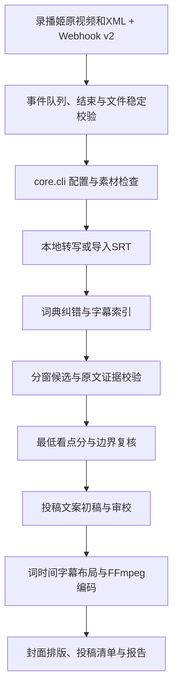

# 主流程架构

| 职责 | 实现 |
| --- | --- |
| 配置、阶段调度、报告 | `core/cli.py` |
| 录播事件、文件配对与串行队列 | `core/recorder_ingest.py`、`core/recorder_webhook.py` |
| 项目路径与旧配置兼容 | `core/paths.py` |
| 密钥加载与任务锁 | `core/local_config.py`、`core/job_lock.py` |
| 转写进程与缓存 | `core/local_transcription.py`、`core/asr_worker.py` |
| FireRed 与 CTC 时间校验 | `core/firered_transcription.py` |
| 词典纠错与审计 | `core/subtitle_correction.py` |
| API 适配与选片校验 | `core/highlight_model.py`、`core/highlight_selection.py` |
| XML/ASS弹幕、时间偏移及反应加权 | `core/danmaku_signals.py` |
| 字幕样式与短句布局 | `core/subtitle_style.py`、`core/caption_layout.py`、`core/subtitle_utils.py` |
| 视频显示方向与渲染 | `core/media_geometry.py`、`core/highlight_render.py` |
| 标题、封面文案及审校 | `core/clip_editorial.py`、`core/cover_copy.py` |
| 封面图片与投稿素材 | `core/clip_publication.py` |
| 原版共享处理与重剪脚本 | `core/video_processor.py`、`core/regen_script.py` 等 |

主流程调用顺序保持原有行为；目录整理主要搬迁入口与资源。缓存使用来源身份、输入和提示词内容，不以提示词所在目录决定有效性。转写模型设置未改变时，可以继续复用本机已有缓存。

FireRed新增逐段检查点与有界局部CTC恢复，分段缓存身份包含录播、运行参数和恢复策略版本，并校验音频样本及结果指纹。对齐失败与GPU设备/运行错误分开传递，前者不再自动退到CPU全量重跑；成功旧整次缓存不因新增续跑机制失效。

默认选片门槛为 85，最终分取初选和复核较低值。字幕证据真实存在，不足以证明角色、情绪或画面解释一定正确。自动结果应通过报告回查；不能将模型评分或工程测试通过数描述为内容准确率。

选片默认面向不了解主播的普通观众。可选XML/ASS弹幕经时间偏移与去重后，为“绷”提供查找线索，并向初选和边界复核提供每窗口最多24条、每条120字的观众评论抽样。评论不是语音证据或已核实事实；只有通过原始质量门槛的候选才按 `priority_score` 加权排序，`score` 保持两轮较低值。弹幕文件内容、时间设置及策略版本进入缓存身份；原始语音证据独立校验。无弹幕时不发送这些辅助字段，照常转写选片。

当前限制：没有音频说话人分离、视频弹幕OCR、自动视觉高光理解、片内多段剪辑或自动投稿。旧版弹幕工具仍是独立工作流；主流程的新弹幕辅助逻辑不调用旧脚本。

可选接入命令 `scripts.recorder_service` 只监听回环地址，Webhook 请求先保存至 SQLite 后返回，不在请求中转写。Session、已知文件打开/关闭事件、安静期及文件稳定校验后，为每个分段冻结配置与来源清单，再调用 `core.cli`。默认 `optional` 优先配同名 XML，缺失时额外等待后仅用视频；`required` 则必须有 XML。存在但无效的 XML 或事件历史不完整时保留等待原因；失败显式重试，中断暂停队列。多分段不合并，尚无整场总片数限制和事件清单对账，详见 [录播接入](../guides/recorder-integration.md)。
